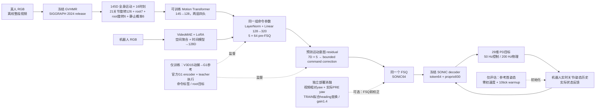

# Research39：当前 Pipeline、retargeting-free 边界与可验证贡献

更新：2026-11-06。对象：R37 GV-only 12000步正式模型；R38按已完成阶段单列。源码审计和本页CPU干预实验不修改运行中的训练、checkpoint或历史评估。

## 1. 可以对外使用的结论

**当前真人路径已更新为 GVHMR 全身运动前端，并与机器人 RGB 路径联合训练同一 SONIC 命令投影。固定训练标签与预训练模型后，新视频命令生成不执行逐视频的人体→G1显式重定向。现有物理结果仍使用参考首姿态初始化，尚不能宣称从训练数据到任意初态部署的全过程 retargeting-free。**

这里“GV-only”只限定**真人入口**，不是“只用人体训练”。R37 的 `fit_domain=J` 同时优化真人与配对机器人；机器人仍经 VideoMAE 和时空聚合。145维人体运动到SONIC的可学习适配仍是跨形态映射，避免的是显式机器人关节轨迹重定向步骤，不能说“人体与机器人之间没有映射”。

## 2. Pipeline 图必须显示的主线与边线



重点按四种角色显示：**冻结基础模型**、**我们训练的适配与共享命令接口**、**真实状态闭环**、**仅训练/仅评估的特权信息**。SONIC decoder始终读取实际状态；root motion-head本身只是视频预测的意图，不是当前状态反馈。朝向反馈是单独部署对照，不默认计入R37主模型。

GVHMR当前为离线全视频估计。命令适配器每个anchor查询[-1.0,+0.5]秒16点，故“没有teacher未来姿态输入”不等于“没有未来RGB信息”；不能把当前方法称为零lookahead、在线实时端到端控制。当前生产worker固定静态相机假设，移动相机尚未验证。

## 3. 数据与推理边界，逐项证据

|环节|实际读取与计算|能否称 retargeting-free|
|---|---|---|
|GVHMR前端|视频→SMPL身体姿态/全局运动/静止概率；无G1关节轨迹输出|人体运动恢复本身不是robot retargeting|
|学习适配|145维人体表示→128维→共享pre-FSQ→SONIC64|学习式跨形态映射；部署无需显式IK/GMR轨迹生成|
|训练标签|V3D15动捕，标定、身体目标、关节优化→G1参考；官方G1 encoder +实际teacher heading生成监督|**不是**全程无重定向数据创建|
|预训练|沿用GVHMR、VideoMAE、SONIC官方权重|没有审计其全部预训练语料，不能宣称预训练数据也从未重定向|
|命令预测|视频估计、已训练参数、时钟；推理禁用数值标签NPZ读取；GV-only不解码human RGB|代码及CPU干预支持不读取teacher未来数值|
|物理执行|冻结预测token、SONIC、机器人实际proprio930|后续控制不需要teacher未来关节；首姿态仍有参考依赖|
|初始状态|参考initial_full_qpos（包含root位置、朝向、机器人关节），速度置零，10个20ms warmup tick|当前指标是**参考首姿态初始化**，不能称任意初态teacher-free|
|root反馈|warmup后初始yaw + 视频相对yaw，与当前PRE机器人yaw比较|不使用未来teacher yaw，但世界方向锚点继承参考初态|
|打分|执行落盘后读取同backend teacher；相同POST时钟，不逐帧对齐|teacher是执行目标代理，不能把G1 MPJPE称人体3D真值误差|

源码定位：

- 真人145D输入、时间窗口、共享head：`scripts/research37/provider.py:12–77`；组成：`scripts/research37/features.py:13–28`。新视频不查teacher的特征入口：`scripts/research37/export_single.py:14–28`。
- 两域joint训练与root监督：`scripts/research37/train.py:123–144`；R38分量加权：`scripts/research38/train.py:124–149`。root标签来自teacher PRE→POST实际运动：`scripts/night30/targets.py:12–25`。
- 动捕→机器人参考的具体转换：`scripts/part1_joint/movi_reference.py:90–192`；`scripts/next_motion_20261015/movi_pair_pipeline_v1.py:101–109`重建pre-FSQ，109行明确记录“not retargeting-free data creation”。
- 正式命令预测的NPZ守卫：`scripts/part2_unified/unified_eval_v2.py:97–139`。provider在training=False跳过数值标签：`scripts/part2_unified/unified_fresh_raw_train.py:31–36`和`scripts/night30/provider.py:27–30`。
- 正式部署只有decoder，不实例化reference encoder：`scripts/part2_unified/unified_eval_v2.py:142–163`；固定参考初始化：190–202行。
- **审计发现的隔离不足**：普通物理评估在rollout前通过`load_source`整体materialize reference NPZ（215、317行）；当前rollout只消费初始状态，但将来代码改动可能误用已在内存的未来数据。不能用收据里的`teacher_future_used_for_student_commands=False`替代数据流审计。更严的导出入口应只接收机器人测得初态，将评分移动到独立进程。
- 普通评估实际执行后才打开teacher实际轨迹（`unified_eval_v2.py:318–331`）。root分支只提取initial_full_qpos，所需yaw来自实际warmup（`scripts/night31/heading_transform_pilot.py:241–275`）。
- R38复用上述root执行器：`scripts/research38_data/root_worker.py:45–60`。三组全部落盘后读取teacher打分：`scripts/research36/root_prepare.py:183–212`。
- `commands_frozen=True`（root_prepare.py:176）表示**该次执行产物已经完成并固定，评分随后开始**；不表示反馈运行前就固定整段token。实际每tick依据PRE yaw重算校正（heading_transform_pilot.py:251–258）。
- 这些NPZ守卫和标记不是操作系统级文件隔离，也不能证明预训练数据无泄漏；应明确它们覆盖的函数、文件类型和时间窗口。

## 4. 已真实执行的最小泄漏/不变性检验

新增脚本和收据：汇报目录 `16_推理效率与方法边界_20261106/method_boundary_cpu_audit.py`、`method_boundary_cpu_audit.json`。2026-11-06使用R37正式12000步checkpoint（SHA前缀527a27ea），S59 walking，一线程CPU，无GPU、无新增训练，耗时9.62秒。

|检验|结果|证明范围|
|---|---|---|
|完整provider构造与8个anchor预测全过程禁止numpy.load；禁止human RGB decoder|通过|当前GV-only预测路径不需要数值teacher NPZ或human RGB解码|
|替换内存teacher target为NaN、teacher/参考metadata为不存在路径|40个命令tick pre-FSQ逐位相同|已训练命令路径没有这些动态teacher输入依赖|
|将真实GV输入置零|pre-FSQ RMS变化0.56512，FSQ坐标变化95.35%|模型确实读取GV；不是质量收益的单独证明|
|固定初态与50个正式token，未来参考数组置NaN|token/action/proprio/qpos/qvel/root全逐位相同|当前物理执行未读取这些未来参考|
|删去全部参考数组，仅保留initial_full_qpos|同上，完整50/50 tick，无跌倒|首姿态之外的reference不是该短执行的必需输入|
|同CPU命令与正式GPU产物比较|max abs pre-FSQ=7.08e-7|确实复用正式模型路径；跨设备浮点不要求逐位一致|

这是**一个动作、40个命令tick与50个控制tick的结构性检验**，不是新的12片精度实验，也没有消除初始参考。未来数组干预在正式tokens下执行，未重新计算评分；故不能将其描述为“替换teacher后评分不变”。新视频与动捕完全脱钩、generic init以及root反馈路径的文件级隔离仍要独立验证。

## 5. 论文表格中的模型名字、预算与粗体

|页面短名|完整ID/阶段|真人入口|训练与状态|
|---|---|---|---|
|RGB同预算|r37_rgb_s371105 @12000|RGB|同父模型、32 TRAIN、同12000步；Human+Robot joint|
|GV+RGB融合|r37_gv_rgb_s371105 @12000|GV + RGB|同预算/同控制器；Human+Robot joint|
|**Ours · GV全身前端**|r37_gv_only_s371105 @12000|仅GV|**当前正式主模型**；Human+Robot joint，机器人仍RGB|
|旧RGB＋朝向反馈|R35/R36固定checkpoint + feedback|RGB + video yaw|历史部署对照；额外反馈/增益，不混入前端同条件排名|
|R38-A 续训|r38_A_continue|GV|父R37续训，同32 TRAIN|
|R38-B 固定接口|r38_B_freeze|GV|冻结共享head与motion映射，GV/机器人适配仍训练|
|R38-C 强化根运动|r38_C_root|GV|motion系数0.1→0.3，平面速度/yawrate加权|
|R38-D 输入正则|r38_D_aug|GV|GV噪声和局部插值，仅训练生效|
|R38-E 组合|r38_E_combo|GV|B+C+D|
|R38-F 扩展动作|r38_F_expand48|GV|48 TRAIN、同更新和query预算；采样组成改变|

R38是候选/阶段结果；主模型身份需待固定协议评估完成再更新，不能因训练更晚就自动称最优。R38原32段前五路每步32个人anchor和32个机器人anchor、6000步；和R37每步8个的12000步不可只按“step”当同预算比较。

R37正式对照：同12段DEV、同12000步、同后端/初始状态/POST时钟、无root反馈。粗体表示**本表均值最优**，并不自动表示统计显著或SOTA：

|模型|q29 rad ↓|世界MPJPE mm ↓|XY m ↓|heading ° ↓|速度RMSE m/s ↓|接触F1 ↑|脚踝滑动代理 m/s ↓|
|---|---:|---:|---:|---:|---:|---:|---:|
|RGB同预算|0.1310|423.8|0.3513|34.12|0.2596|0.8383|0.0679|
|GV+RGB融合|0.1309|428.6|0.3552|35.39|0.2630|0.8421|**0.0647**|
|**Ours · GV全身前端**|**0.0986**|**289.4**|**0.2468**|**20.54**|**0.1773**|**0.9167**|0.0996|

所有主表模型完整12/12，0跌倒。Ours相对RGB q29均值降低24.7%，世界MPJPE降低31.7%，XY降低29.8%；但脚踝滑动代理更差，不能全行加粗数值。机器人输入保持也有代价：相对RGB，q29改善0.00251rad，XY退化0.02724m、heading退化6.47°、世界MPJPE退化22.77mm。

证据来自R37 `review/results.json` 和汇报14的同源配对JSON；DEV反复用于研究，不能冒充封存TEST。指标以同backend teacher执行为目标，不是人体motion capture的空间真值。不同实验阶段/输入域/反馈条件分别比较，领先数值统一按指标方向自动加粗；样本少时显示逐片配对差和受试者聚类区间。

## 6. 目前可支撑的贡献与下一批最小实验

1. **人体运动估计作为实际部署输入**：代码路径、小测及已完成的estimated/zero/time_reverse共同支撑。GV-only时间反转使q29增0.04106rad、世界MPJPE增112.20mm（12个完整共同片段）；置零3/12提前失败，完整共同片段仅9个，必须保留分母。
2. **两域共享命令接口**：同一参数对象和joint梯度明确；两域使用不同输入编码器。还不能仅靠共享维数宣称语义自动对齐、完全统一视觉前端或跨机器人泛化。
3. **省去每个部署视频显式重定向**：已存在新视频GVHMR结果→145D入口，正式命令推理与CPU干预支持。不等于消除训练标注转换成本，也不等于效率优于重定向方法。
4. **实际状态朝向校正**：固定TRAIN变换与同模型部署消融可单独支持，R37主结果不含该收益。需要全12片同条件汇总，不能用单个walking示例推出普遍提升。

效率核算须分开列出数据准备、一次性训练、每个新视频推理和物理执行。通用运动追踪器也可能无需逐视频重训；不能假设所有显式重定向基线都要重新训练。应比较同视频、同硬件下“GVHMR＋显式重定向＋冻结追踪器”和“GVHMR＋学习适配＋SONIC”的质量与完整时间；若追踪器不同，须另做同控制器消融。

下一批实验按优先级固定协议，不在DEV反复择优：

|实验|固定输入与干预|验收与输出|当前状态|
|---|---|---|---|
|E1 完整teacher隔离|新视频、checkpoint、机器人测得初态；文件白名单不含teacher/labels/reference；命令与rollout进程不加载评分模块|全流程成功；开放/屏蔽teacher下命令和轨迹相同；记录文件访问|局部CPU审计已做，完整入口待做|
|E2 通用初态|固定站姿/多yaw/关节小扰动与参考首姿态并列；每种同控制器、无逐视频调参|完成率、摔倒、恢复时间、root-relative与世界误差分开|待做；历史generic-init模块不能自动算当前GV模型证据|
|E3 root反馈隔离|相同视频、初态和随机种子；替换未来teacher yaw与关节，分别off/on/gain|实际每tick校正token与轨迹不变；评分独立重算|源码审计通过，当前模型文件级干预待做|
|E4 同硬件端到端效率|相同视频、分辨率、片长、精度；冷/热分别测GVHMR、适配、控制；显式retarget基线也含同样输入准备|首动作延迟、总wall time、RTF、峰值内存、每分钟视频时间；报告是否含下载/渲染|见同目录效率审计；未测项不填推估FPS|
|E5 公平重定向基线|GVHMR→固定显式retargeter→同SONIC/PD，与GVHMR→学习适配；相同初始化/视频/时钟|质量与计算Pareto；记录失败；任何参数只在TRAIN选|待实现/登记，不能宣称已超越|
|E6 封存测试|固定主模型、反馈、超参后开封；新增受试者/场景/运动相机单列|完整分母、跨种子、配对区间；无TEST选择模型|封存TEST尚未打开|

复现CPU审计：
```bash
OMP_NUM_THREADS=1 OPENBLAS_NUM_THREADS=1 ../conda_envs/roboghost-py310/bin/python -B \
  科研汇报_20260917至20261103/16_推理效率与方法边界_20261106/method_boundary_cpu_audit.py
```

