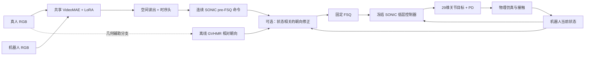

# 从跨外观的视频理解到有状态的机器人执行：Pipeline的研究逻辑

更新于2026年11月4日。本文结合实际源码、Research34终态双种子结果、Research35已完成的状态实验与正在运行的六臂实验。精确数值、来源与视频见同目录[最新结果](02_最新结果与进度_自动更新.md)、[证据与消融矩阵](03_模块消融矩阵与下一步.md)、[视频说明](04_Demo观看顺序与证据.md)。

## 1. 我们要解决的研究问题

给定真人或机器人视频，学习一个共享的video-to-command模型，让机器人在物理环境中重现视频中的动作与空间运动。共享模型需要同时处理两种差异：**图像外观不同，但动作语义可以相同；动作意图相同，但机器人当前状态不同，所需执行命令也可能不同。**

前一种差异对应人机联合训练，后一种差异对应状态条件化与闭环执行。把这两个问题分开，才能解释为什么双域overfit已经成立，但真实执行中的朝向和位移仍会出问题。

研究目标可表述为：通过机器人可执行的共享运动表示，把真人视频与机器人视频的模仿任务连接起来；部署时直接预测控制接口所需的运动命令，减少逐视频人体重建、运动重定向、轨迹优化再跟踪的串行依赖。当前RGB主线已经采用这一形式。训练标签仍由同步动捕和G1参考转换获得；加入GVHMR的几何辅助版本在推理时增加了人体运动估计。因此，汇报要分别画出RGB直接路径与几何辅助路径，并明确各自输入。

**最有证据支持的贡献叙述：**双域视频可以共享同一可执行命令接口；联合训练能维持两种输入的动作能力；运动命令与执行状态的坐标关系，是从视觉拟合走向全局运动跟踪的重要条件。更大规模的人域泛化优势仍在通过受控实验推进。

## 2. 三条路径及其关系

- **历史原生路径**：机器人RGB → VideoMAE/空间头/Direct或Flow → native 8×32表示 → 原生diffusion控制器 → G1。J9保留这条路径，在真人特征端加入域adapter。它证明原有机器人链路可用，也提供真人接入的早期基线。
- **当前共享SONIC路径**：两域采用同一视觉forward → 2×32 pre-FSQ → FSQ → 同一SONIC控制器。两域无单独的J9式adapter；Joint训练让同一组参数接收两域梯度。
- **几何和状态增强路径**：在上述结构上比较几何融合、RGB预测motion intent和实际朝向反馈。它们是不同实验，不能画成一条已经同时训练并验证过的完整网络。

原生与SONIC的latent、proprio、动作维数、低层策略和PD契约不同。当前统一的是**两种输入域在SONIC主线内的接口**，并未把历史native控制器也改造成SONIC控制器。两套完整系统的结果可对照，但其差异不能仅归因于latent的维数。

### 2.1 原生路径每个特有模块保留了什么思想

|原生模块|为什么存在|已有依据与与当前主线的关系|
|---|---|---|
|未来状态编码器E：10×69→8×32|将未来关节、root旋转/速度和接触压缩成可供控制器使用的结构化表示|与原生控制器共同适配；属于原生运动坐标系，不能与SONIC64直接互换|
|语义重建头：articulation/root/event|通过重建防止表示只拟合动作而丢掉未来状态信息，为root和接触提供检查接口|训练时使用，部署控制路径不经过；没有“去重建头重训”的完整独立消融|
|token-conditioned diffusion控制器|在命令和本体历史条件下生成关节动作，分担视觉之外的低层控制问题|历史2步DDIM与专家动作蒸馏/状态聚合形成可运行后端；采用diffusion的最优性未由当前实验单独证明|
|Direct或Flow视觉命令头|Direct回归命令，Flow学习从噪声到条件命令的向量场，表达候选命令生成方式|它们是候选前端，不是Direct→Flow串行两次变换；Flow有效demo可证明端到端可用，不能推出其泛化一定优于Direct|
|J9人体域残差adapter|保护已有机器人特征路径，同时给人体外观一个有限适配入口|零初始化、robot绕过；后续共享时序头。当前SONIC主线改为两域完全共享forward|
|fixed-support后端适配|让原生控制器更匹配当时的命令与支撑状态分布|同一J9视觉前端下蹲起改善属于后端匹配证据；没有通过该新后端联合重训J9，不能据此称为新的视觉学习收益|

原生链路的经验不是“必须换掉原控制器”，而是**表示与控制器需要共同定义契约，视觉预测准确度还必须通过实际执行来判断**。SONIC主线复用较稳定的发布控制接口，便于隔离双域视觉学习与root适配问题；原生路径仍是研究对照和已有成果。详细维度与原生loss保留在[历史方法说明](../03_Pipeline与训练方法.md)。

## 3. 训练数据如何定义“同一个动作”

MoVi提供同步真人RGB和动捕。离线将动捕转换为G1参考，再执行teacher并记录命令、本体状态、实际轨迹和机器人渲染，按统一时钟形成：

\[
(V^H_t,V^R_t,u_t^*,s_t^T,\tau^T).
\]

其中，\(V^H,V^R\)是两域图像，\(u^*\)是同一时刻的连续控制表示，\(s^T\)是teacher状态，\(\tau^T\)是teacher物理轨迹。视频、命令和状态对齐比“视频看起来类似”更强：两域监督指向同一个执行目标，提供跨外观的共同坐标系。

Teacher标签的用途有三项：固定可学习目标、隔离视觉与低层控制误差、提供实际执行的定量参照。Teacher本身也有跟踪误差，所以评价student对teacher的逼近程度，不等同于验证其对真人动作的全部保真程度。

部署student时，RGB模型不读取未来动捕或teacher动作；低层控制器读取自己的本体历史。已有评价使用共同参考初态，因此“独立物理执行”成立，“任意初态自主启动”则需另外验证。视频中的teacher列只是评分参照，不是把teacher状态复制给student。

六段overfit有每段真人和机器人输入，两个训练种子：Joint人域q为0.02884rad、机器人域0.02803rad；robot-only在人域约0.247rad。它说明共享映射能拟合、输入域差异必须学习处理。它不证明未见动作泛化，也不证明每个隐藏层都已域不变。当前广池训练使用261个有效TRAIN动作片段，来自27个原录制、14类动作；片段数量、原录制数量与人物数量应分别报告。

## 4. 视觉前端：为什么不能只看一帧

### 4.1 双时间窗口与VideoMAE

每个10Hz锚点取0.6秒和2秒两路16帧RGB，letterbox到224×224，经过VideoMAE得到每路49×768空间特征。短窗口描述较快的局部动作，长窗口为动作阶段和较慢变化提供上下文。同一个关节姿态可能出现在抬手和放手过程中，单帧不能唯一决定接下来的命令；多帧有助于区分运动方向、阶段和节奏。

目前采用0.5秒RGB lookahead。时序头有causal mask，但整套输入仍有前瞻；离线视频模仿可接受这一设置，若讨论实时控制则应显式报告延迟。双窗口的有效性属于设计假设，尚缺同数据同训练预算的单窗口重训对照。

VideoMAE主干绝大部分固定，只在最后4个block的query/value投影加入rank8 LoRA。冻结前8层可缓存特征、降低重复计算，后4层允许人体/机器人外观适配。LoRA的作用是可训练的域适配自由度，不是自动跨域对齐的保证。历史吞吐和梯度检查证明其能训练，不等同于证明rank8或末4层是最优结构。

### 4.2 静态特征与差分

模型同时输入标准化特征\(x\)和\(x-x_{static}\)，投影1536→128。当前raw实现中的\(x_{static}\)来自**第一帧重复16次**的静态clip，不是相邻锚点的时间导数。它使网络可以同时使用身体外形/姿态和相对初始画面的变化。

这种差分有助于突出动作，但摄像机运动、遮挡与人体位置变化也会改变它；它不是已经分离出的3D运动或光流。完整网络可用不足以证明差分支路必要，需做保留绝对特征、去掉差分的重训实验，并分别观察相位、动作幅度与相机扰动。

### 4.3 空间query与时序头

两路49个位置合成98个空间token。4个可学习query通过4头cross-attention读取空间信息，残差归一化后平均得到128维表示。它提供对身体不同区域的自适应读出；query没有手、脚、root的人工绑定，不能直接称为四个解剖部位模块。

8个锚点进入2层Transformer（128维、4头、FFN512），输出五个连续的64维命令，对应50Hz执行子步。这将10Hz视觉更新与更高频的控制连接起来，五个子步不是简单重复一个姿态。时序模型的用途是利用动作历史和相位信息；目前没有完整的“无时序头”“均值池化替代query”重训结果，讲解时应以功能和可检验假设为依据。

## 5. 为什么需要共享中间表示，而不是直接回归PD动作

PD动作依赖当前机器人姿态、速度和接触状态。同一视频意图在不同机器人状态下，恢复平衡或完成动作所需的关节目标可以不同。若仅从视频直接回归动作，视觉模型必须同时学习图像理解和状态相关控制；共享运动表示把这两类问题分开。

当前命令头预测\(\hat u\in\mathbb R^{5\times2\times32}\)，每个子步经固定FSQ得到64维命令，再由SONIC decoder结合930维proprio生成29维动作。共享latent的价值来自它与已有控制器共同训练的可执行语义，不能只由“64维”或“量化”推出。

联合训练对同一动作的两域使用共同命令目标，使输出在同一坐标系中有监督地靠近。它不要求所有中间视觉特征都完全相同；外观信息与任务信息可以共存。额外强制隐藏特征相似可能有帮助，也可能损伤对运动有用的细节。已有显式alignment实验VAL q为0.19173，对照0.19154，当前设置没有收益。

**FSQ的具体意义**是保持发布控制器的输入契约，并限制命令的标量取值。它也会让小幅连续变化量化后消失，因此需同时检查pre、token、decoder输出和物理执行。对冻结控制器直接取消FSQ会改变输入分布，只能作为接口敏感性诊断；要证明量化本身是否必要，需要重新匹配控制器训练，不能把一个不兼容的输出替代当作公平消融。

## 6. 低层控制与PD：为什么身体动了，root仍可能不对

SONIC的930维proprio是10帧历史，按字段排列：局部角速度3、关节角29、关节速度29、上一动作29、投影重力3，共每帧93维。输入总维数994=64+930，输出29维动作，按关节顺序、默认角和scale转换为PD关节目标。

\[
q^{des}_t=q_{default}+S\pi_\phi(Q(u_t),s_t),\qquad
\tau_t\approx K_p(q^{des}_t-q_t)-K_d\dot q_t.
\]

实际执行还受仿真执行器和力矩限制影响。G1的root是自由浮动基座，不能通过29个关节PD直接指定全局平移；位移由步态、平衡和地面接触共同产生。这解释了为什么关节形状相近、接触稳定，仍可能走得太短或走错方向。

该proprio不显式提供全局XY、绝对yaw或root线速度；重力方向也不能确定绝对yaw。低层策略可从历史和步态线索形成稳定控制，但不能据此假设它会自动纠正所有视频相对世界的走位误差。新增状态反馈若部署到真实机器人，需要可靠的本体朝向估计；当前实验使用仿真实际yaw。

这里低层控制器和FSQ保持冻结；最新训练主要更新视觉LoRA、空间/时序头和可选motion分支。结果不能归因于本轮重新训练了SONIC的RL控制策略。原生控制器历史上使用动作蒸馏、扩散目标、语义重建和DAgger，具体结构与loss见上一级方法说明。

## 7. Root问题的关键：标签不是完全脱离执行状态的运动意图

当前SONIC G1编码入口实际读取未来10帧关节角、关节速度、相对当前机器人yaw的root旋转；该入口未显式填入目标root平移或线速度。

\[
u_t^*=E(q^*_{t:t+9},\dot q^*_{t:t+9},R_z(-\psi_t^T)R^*_{t:t+9}).
\]

未来采样间隔0.1秒。teacher标签以teacher当前yaw \(\psi_t^T\)编码；student随后运行在\(\psi_t^S\)。当二者偏离，继续预测固定标签并不等同于根据student状态重新发出相同世界方向的意图。**因此，当前pre-FSQ表示应称为控制器运动命令，而不能未经证明就当作完全状态无关的语义意图。**

这不是说SONIC不能行走。步态、关节速度和方向可以间接表达运动，已有片段有接近teacher的路径长度。更具体的问题是：现有监督没有直接要求模型在student访问到的不同状态下纠正全局速度与累计位移。

### 7.1 朝向修正为什么有效

从GVHMR获取视频相对初始朝向变化\(\Delta\hat\psi^V_t\)，建立：

\[
\psi^{desired}_t=\psi^S_0+\Delta\hat\psi^V_t,\quad
\delta_t=\operatorname{wrap}(\psi^S_t-\psi^{desired}_t),\quad
\tilde u_t=T_\eta(\hat u_t,\delta_t).
\]

TRAIN中固定同一未来G1运动，用不同当前yaw重新编码得到监督，拟合ridge或MLP命令变换。ridge输入包含标准化pre与sinδ、1−cosδ的交互，输出有界近似残差；δ=0严格返回原命令。执行时只读冻结RGB预测、视频估计朝向、实际PRE yaw和初始yaw，不读取未来teacher轨迹。

在12个有几何的旧DEV/VAL上，旧RGB模型加ridge：heading **43.58°→5.26°**，XY **0.3650→0.3062m**，速度RMSE **0.2823→0.2361m/s**，q **0.13276→0.12987rad**。零修正精确复现原轨迹；错时朝向明显更差；同一前端和控制器保持不变。这组干预比“加模块后总分略好”更直接支持**坐标/执行状态匹配确实重要**。

将同一思路用于新Joint模型，teacher-input拟合适配器在12段上使heading **38.06°→5.23°**、XY **0.3296→0.2903m**、速度RMSE **0.2608→0.2260m/s**。这是一个小型状态变换发挥作用的证据，不需要先把整个视觉网络重做。

仍需区分单段展示与总体实验：视频05使用已有ridge迁移到新Joint模型，单段101.64°→7.31°；上面的12段5.23°来自新模型对应的teacher-input适配器。两个实验的标签与来源在数据中分列，不能当作完全同一配置。

### 7.2 为什么方向修好后路程仍不足

新Joint＋teacher-input适配器在9个移动片段中的平均路径比约0.546，未修正约0.541，方向改善没有同等幅度地增加路程。S57展示片段路径1.10m，对照teacher2.81m。路径比接近1也只是必要线索，走错方向或绕圈都可能得到相同路径长度，所以需同时看heading、速度向量、终点和XY。

目前证据把“方向坐标错配”与“推进幅度不足”分开了。后者需要检查期望速度是否可辨识、标签是否包含该目标、token变化是否真正影响步态，以及脚部接触是否允许实现该速度。不能简单将pre乘常数解释成已校准的物理速度控制。

## 8. GVHMR、motion intent和实际状态修正各自承担什么角色

|分支|推理输入|功能|已有证据|
|---|---|---|---|
|RGB预测motion intent|同一RGB表示|128→128→35预测5×7物理量，再35→128→320产生有界pre残差|双种子整体无明显收益；置零/反序对命令影响很小|
|GVHMR特征融合|RGB＋离线估计几何＋availability mask|为命令预测补充局部速度、yaw rate、高度变化和相对yaw|同checkpoint干预收益温和、部分指标无改善|
|heading状态变换|冻结RGB pre＋GVHMR相对yaw＋机器人实际yaw|将视频方向意图转换为适应当前执行状态的命令|12段方向与速度向量显著改善，错时对照更差|

第一行的七维监督为**teacher实际局部线速度3、局部角速度3、高度1**，来自物理轨迹；第二行GVHMR七维为**局部线速度3、yaw rate1、相对高度1、相对yaw的sin/cos2**。它们维数相同，语义不同，不能直接视为同一个root输入。

motion intent有辅助SmoothL1监督，命令残差末层零初始化，保护父模型的起始行为。Research34两个种子control→intent：55段q分别0.15214→0.15289、0.15297→0.15386；heading有约0.28°的小改善，XY无一致方向。6段DEV同checkpoint置零：pre差RMS仅0.000450，token元素改变率0.562%；未来5个query反序为0.000063、0.075%。因此，模型对这一路输入变化在量化前已不敏感，原因不能全部归给FSQ。置零仍保留MLP bias，因此这一实验也不能证明整个分支严格无贡献。

同一GVHMR融合checkpoint的estimated/zero/shift干预，12段XY约0.3702/0.3922/0.3929m，heading约38.47/38.49/40.05°。正确几何对位置有帮助，但单纯融合没有复现状态修正的大幅朝向收益。由此推断：**几何是否可用和几何是否接到正确的状态条件关系上，是两个问题。**

GVHMR目前采用离线估计，有尺度、遮挡和域偏差；它提供有价值的几何观测，不是全局平移真值。其加入支持“带几何的辅助版本”；希望最终保持更直接的RGB部署时，可把可靠几何作为训练期辅助监督或蒸馏目标，另行验证RGB-only能保留多少收益。

## 9. 联合训练及各项loss应怎样解释

Research34/35实际目标按域加权求和：

\[
L=L_H+\lambda_RL_R,\qquad
L_d=L_{cmd,d}+\lambda_\Delta L_{\Delta,d}+\lambda_m L_{motion,d}.
\]

\[
L_{cmd}=\operatorname{mean}\big((\hat u-u^*)/\sigma\big)^2,
\quad L_\Delta=\operatorname{mean}\big((\Delta\hat u-\Delta u^*)/\sigma\big)^2.
\]

\(\sigma\)为冻结的标签尺度。差分沿同一来源的有序锚点计算，对应同一未来子步槽；它不是额外惩罚预测运动幅度，也不是相邻20ms物理帧的直接速度惩罚。实际锚点间距应随schedule核对，不能把它无条件写作物理导数。

Research34 P0组H为\(L_H\)、J为\(L_H+L_R\)，人域系数、锚点和更新数匹配；J仍增加机器人数据曝光及计算。旧night31则按域数平均，讲解最新结果时不可沿用旧权重公式。优化器为AdamW，LoRA和head学习率当前5e−5，梯度裁剪1；head weight decay 1e−4、LoRA为0。

当前六臂的action和显式alignment权重均为0，motion weight=0.1；它们继续训练同一Joint+intent父模型。机器人域系数取0.25/0.5/1，配合目标差分权重0/0.1，并包含H-only续训。这样可以检验跨域梯度取舍和目标差分监督，而非把所有不足归咎于网络容量。

### 9.1 双种子最终结果改变了什么判断

固定55段、人域输入，P0第一种子H→J：q0.15156→0.14723，XY0.15372→0.14758，世界MPJPE199.88→193.03mm；第二种子：q0.14999→0.15036，XY0.13313→0.13828，世界MPJPE176.73→184.01mm。泛化优势尚不稳定。

但相同12个已见机器人动作，两个种子H→J的q分别0.30770→0.12607、0.30472→0.12607rad，收益重复出现。Joint当前最扎实的作用是**维持同一个模型对两个输入域的有效映射**，而不是保证每个真人新动作都优于单域模型。

43段VAL人物聚类区间也支持这一解释：第一种子J−H的q差95%区间约[−0.00563,+0.00055]，第二种子约[−0.00802,+0.00725]。只有5个人物，区间反映该样本上的不确定性；两个种子是训练重复，不应与片段数相乘后冒充更多独立人物。

## 10. 怎样用指标把“像不像”分解清楚

- **局部动作形状**：q29、腿/臂误差、仅去root平移的G1-29 MPJPE。后者保留heading差异。
- **世界运动**：全局MPJPE、root XY/XYZ、heading、root速度向量RMSE、路径比和终点误差。
- **动态与接触**：身体速度/加速度误差、脚部轨迹、接触F1、接触期踝部水平速度代理、腾空与高度幅度。
- **覆盖和稳定性**：完整执行率、评分时长、提前终止原因、全部登记分母。持续站立也能得到完整率，必须配合动作和路径指标。

所有当前数字按相同POST时钟比较，不做逐帧朝向对齐、Procrustes或DTW。G1-29是机器人link原点集合，不是人体SMPL关节；与其他论文比较时需统一body集合、参考、频率、初态、终止条件和支持时段。0.1rad约5.73°只帮助理解角度尺度，不能替代全身空间指标。

直接demo用于解释具体行为与失败位置；全组统计用于判断总体效果。两者要同时出现。连续120秒demo证明长时间独立运行，但其中俯身/低姿态等动作仍可能跟随不足，而且没有全片GT；适合作为长时稳定性与开放问题的补充，不能替代短段的定量跟踪结果。

## 11. 为什么还保留视觉RL方向

当前监督目标优化“预测teacher命令”，而我们最终想优化“机器人实际执行与输入动作的相似程度”。从实际状态出发，通过latent或视觉运动距离定义reward，有机会直接优化后者，并学习teacher固定标签未覆盖的恢复行为。

这要求reward能区分原地踏步与真正位移、方向正确与错误、动作相位相同与相反；否则策略可能通过站稳或容易的局部动作获得高分。已有11对实际RGB排序探针中，原始VideoMAE在fit/check分别2/8、2/3，旧head为6/8、1/3；目前不足以把该距离作为主要RL奖励。

合理推进顺序是：保留已成功监督模型；在同状态真实rollout上建立方向/幅度/相位难例；先验证reward的可辨识性；再以有界命令残差进行小规模策略优化，并与同预算搜索/蒸馏比较。当前60次速度搜索属于TRAIN短窗控制诊断，不是PPO。它在dynamic1.4下速度误差改善4.44%、路径增8.98%，提示命令中有可利用的动态自由度，但还需要完整DEV验证。

## 12. 汇报时可以落在这三个判断

1. **可行性已成立**：同一视觉模型可以通过共同控制接口把真人与机器人视频转为独立物理执行，六段双域拟合是最清楚的证据。
2. **模块关系比堆叠模块更重要**：状态相关的运动命令需要与当前执行坐标匹配；GVHMR相对朝向＋实际yaw修正提供了具体、可复验的改进证据。
3. **下一步围绕可检验瓶颈推进**：用多种机器人梯度权重与目标差分消融研究双域取舍，用真实速度反馈研究推进不足，再扩大人物、动作与视角覆盖。空间头、时序头、LoRA的必要性需要受控重训检验。

源码依据：`unified_model.py`定义共享头与部署decoder；`unified_fresh_raw_train.py`定义窗口/静态输入与可训练视觉层；`sonic_interface.py`定义命令和本体状态契约；`research34/train.py`定义当前loss；`night30/provider.py`及`targets.py`定义motion分支；`night31/geometry_provider.py`定义几何融合；`heading_transform_pilot.py`、`research34/state_tasks.py`定义朝向修正与命令冻结后评分。源码副本和hash见本目录数据。
